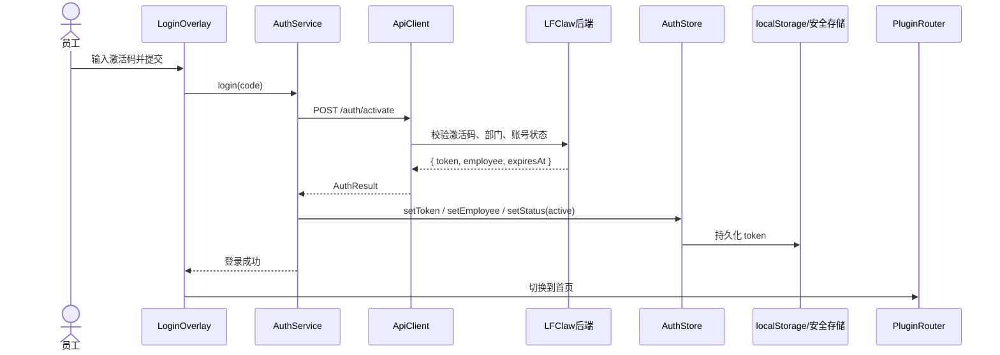
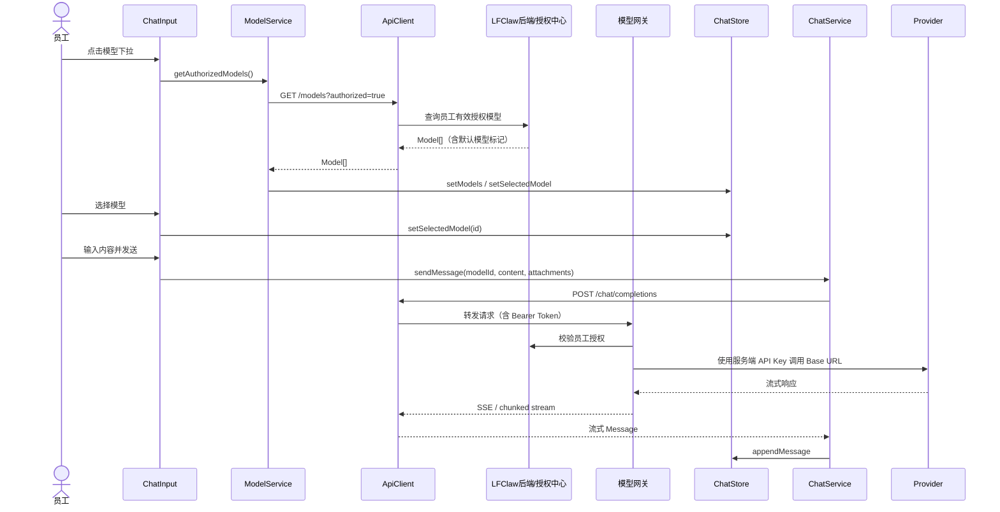
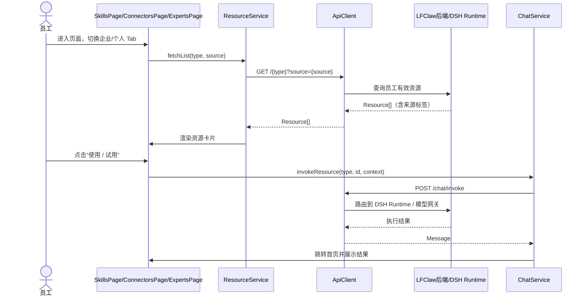
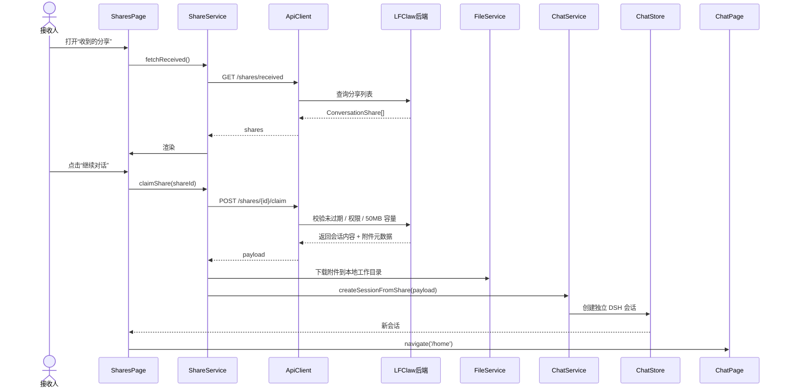
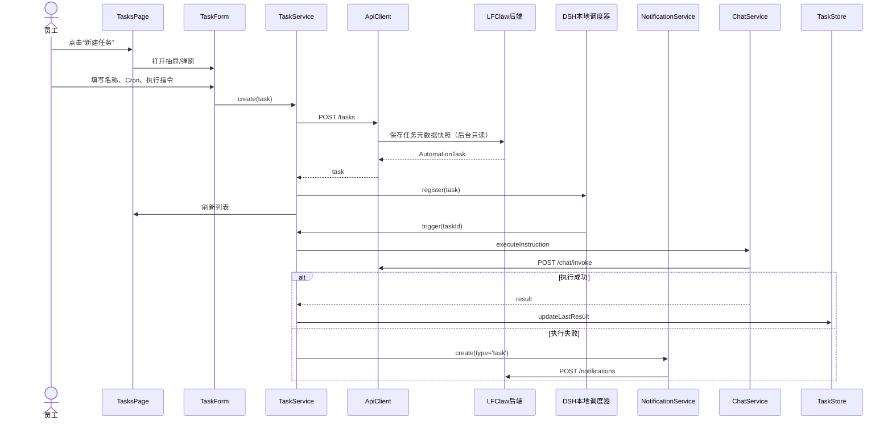
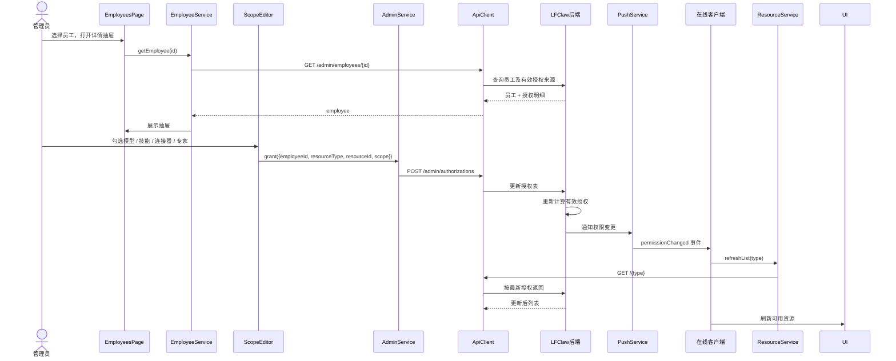
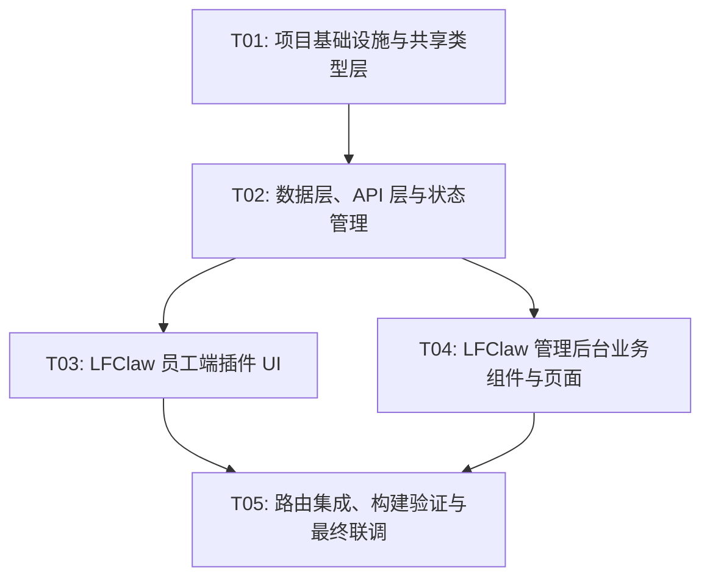

# LFClaw 系统架构设计与任务分解

> 版本：V1.1（根据 team-lead 2026-10-14 反馈修订）
> 基于 PRD：`D:/deepseek-harness/deliverables/software-company/LFClaw_PRD.md`
> 需求基线：`D:/deepseek-harness/需求文档/LFClaw_需求_提取.txt`
> UI 参考：`D:/deepseek-harness/LFClaw_UI_Complete_20_Images_Windows (1)/`

---

## Part A：系统架构设计

### 1. 实现方案与框架选型

#### 1.1 架构决策

仓库现有 `apps/desktop`、`apps/web`、`apps/desktop-host`、`apps/cli` 是 DeepSeek Harness（DSH）自身的产品入口，构建链、产物、版本与 DSH 上游深度绑定。结合 team-lead 反馈，LFClaw 的落地策略如下：

- **员工端**：不新建独立 Electron 应用，而是扩展既有 DSH 客户端插件 `packages/client/ui-lfclaw`。该插件已通过 `dsh.client` 注册为侧边栏面板，天然运行在 DSH Desktop / Web 环境中，能直接复用 DSH Runtime、会话、插件体系。
- **管理后台**：新建独立 Web 应用 `apps/lfclaw-admin`，使用 Vite + React + TypeScript，与 DSH 既有应用保持同级目录，但源码隔离。
- **共享层**：新建 `packages/lfclaw-types` 存放两个端共用的业务类型，避免类型重复。

这样可在不破坏 DSH 既有构建与发布的前提下，获得 LFClaw 独立品牌界面与后台，并随 DSH 上游升级选择性同步。

#### 1.2 核心技术挑战

| 挑战 | 应对思路 |
|------|----------|
| 员工端开箱即用，仅输入激活码 | DSH 安装包预置企业后端地址；插件内提供激活码登录浮层/弹窗；登录后持久化 token |
| 企业/个人资源隔离与权限同步 | 服务端计算“有效授权 = 部门继承 + 个人覆盖”；插件通过轮询/事件刷新；API 层严格以 token 校验 |
| 聊天、会话、定时任务本地优先 | 会话与任务元数据走 LFClaw 后端，实际执行委托给 DSH Runtime；后台只读任务元数据 |
| 会话分享含附件与 AI 文件 | 后端磁盘临时存储（30 天 / 50MB），领取时下载到本地并创建独立 DSH 会话 |
| 模型网关安全调用 | 企业模型 Base URL 与 API Key 仅保存在服务端；客户端只传 modelId |
| 双平台 Electron 打包与强制更新 | 复用 DSH `apps/desktop` 的 Electron 与更新链；LFClaw 插件随 DSH 客户端分发；版本包管理在 `apps/lfclaw-admin` |
| 管理后台复杂表单与授权 | 使用 `zod` 做表单校验；统一 `ScopeEditor` 组件配置全员/部门/员工范围 |

#### 1.3 技术栈

| 层级 | 选型 | 说明 |
|------|------|------|
| 员工端构建 | `tsdown`（与 `packages/client/ui-lfclaw` 现有脚本一致） | DSH 客户端插件使用 tsdown 打包，被 DSH web roster 加载 |
| 管理后台构建 | Vite 6 + TypeScript 6 | 与 `apps/web` 构建工具版本对齐 |
| 前端框架 | React 18 | 函数组件 + Hooks |
| 组件库 | `@deepseek-ai/dsh-client-ui-primitives` | 复用 DSH 原子组件：Button、Input、Switch、Checkbox、Tag、Modal、Toast、Menu、Pill、SegmentedTabs 等 |
| 样式 | CSS Modules + `--dsw-*` 设计令牌 | 参考 `packages/client/ui-lfclaw/src/client/LfclawPage.module.css`；管理后台在入口引入 `@deepseek-ai/dsh-client-ui-theme` 的 base/design-platform CSS |
| 路由 | 管理后台：`react-router-dom` v6；员工插件：内部 `MemoryRouter` / 自定义页面路由器 | 管理后台为独立 Web，使用 URL 路由；员工插件作为 DSH 面板，使用内部路由 |
| 状态管理 | Zustand ~4.5.7（与 `@deepseek-ai/dsh-client-store` 引擎一致） | 轻量全局状态：auth、employee、resources、chat、tasks、shares、notifications |
| HTTP 请求 | 统一 `ApiClient`（基于 `fetch`） | 拦截器注入 token、统一错误码、401 触发退出登录 |
| Mock / 后端占位 | Service 层 `USE_MOCK` 开关 + `mock/handlers.ts` | 开发阶段返回符合 `{code, data, message}` 的样例数据；关闭后直连 `VITE_API_BASE_URL` |
| 表单校验 | `zod` | 统一 schema 校验 |
| 日期/定时 | 优先使用 `@deepseek-ai/dsh-client-ui-primitives` 的 `relativeTime`；Cron 解析按需引入轻量库 | 不引入未在仓库中出现的大型日期库 |
| 图表 | 总览趋势图优先使用 CSS/SVG 简单自绘；如需复杂图表再评估 | 与 DSH 现有组件风格保持一致 |
| 桌面端运行 | DSH `apps/desktop` + Electron 44 | LFClaw 员工界面以插件形态随 DSH Desktop 启动 |
| 测试 | Vitest + `@testing-library/react` + Playwright | 与仓库现有测试体系一致 |

#### 1.4 应用架构模式（MVVM 变体）

```
┌─────────────────────────────────────────────────────────────┐
│  UI 层（Pages / Components / *.module.css）                   │
│  - 纯展示与交互，不直接调用 fetch                              │
├─────────────────────────────────────────────────────────────┤
│  ViewModel / Hooks 层                                        │
│  - useAuth / useResources / useEmployees ...                  │
│  - 组合 Zustand store 与 Service，提供组件可用的数据与回调     │
├─────────────────────────────────────────────────────────────┤
│  Service 层                                                  │
│  - AuthService / ResourceService / ChatService ...            │
│  - 封装业务语义，调用 ApiClient                                │
├─────────────────────────────────────────────────────────────┤
│  API 层                                                      │
│  - ApiClient（fetch 封装 + 拦截器）                           │
│  - 按领域拆分的 api/*.ts，对应后端 REST 接口占位               │
├─────────────────────────────────────────────────────────────┤
│  Store 层                                                    │
│  - Zustand：token、employee、UI 状态、chat 会话               │
└─────────────────────────────────────────────────────────────┘
```

---

### 2. 文件列表

#### 2.1 员工端插件：`packages/client/ui-lfclaw/`

> 既有包已存在，以下列出需要保留/扩展的关键文件。

```
packages/client/ui-lfclaw/
├── package.json
├── tsconfig.json
├── tsdown.config.ts
└── src/
    ├── index.ts                    # 已存在：node 侧 apply（空实现）
    └── client/
        ├── index.ts                # 已存在：注册 DSH 面板与侧边栏图标
        ├── LfclawIcon.tsx          # 已存在：侧边栏图标
        ├── LfclawPage.tsx          # 已存在：扩展为插件内主布局 + 页面切换
        ├── LfclawPage.module.css   # 已存在：基础布局与令牌样式
        ├── locales.ts              # 已存在：扩展为中文/英文文案
        ├── css-modules.d.ts        # 已存在
        ├── routes.tsx              # 新增：内部 MemoryRouter 路由配置
        ├── api/
        │   ├── client.ts           # 新增：fetch 封装
        │   ├── auth.ts
        │   ├── employee.ts
        │   ├── department.ts
        │   ├── model.ts
        │   ├── skill.ts
        │   ├── connector.ts
        │   ├── expert.ts
        │   ├── plugin.ts
        │   ├── task.ts
        │   ├── share.ts
        │   ├── notification.ts
        │   └── mock/
        │       └── handlers.ts
        ├── store/
        │   ├── authStore.ts
        │   ├── employeeStore.ts
        │   ├── resourceStore.ts
        │   ├── chatStore.ts
        │   ├── shareStore.ts
        │   ├── taskStore.ts
        │   └── notificationStore.ts
        ├── hooks/
        │   ├── useAuth.ts
        │   ├── useEmployee.ts
        │   ├── useResources.ts
        │   ├── useChat.ts
        │   ├── useShares.ts
        │   ├── useTasks.ts
        │   └── useNotifications.ts
        ├── components/
        │   ├── layout/
        │   │   ├── PluginLayout.tsx
        │   │   ├── PluginSidebar.tsx
        │   │   ├── PluginTopBar.tsx
        │   │   ├── UserProfile.tsx
        │   │   └── SessionHistory.tsx
        │   ├── common/
        │   │   ├── StatusBadge.tsx
        │   │   ├── ResourceCard.tsx
        │   │   ├── EmptyState.tsx
        │   │   ├── ConfirmDialog.tsx
        │   │   └── SearchFilterBar.tsx
        │   └── chat/
        │       ├── ChatInput.tsx
        │       ├── ModelSelect.tsx
        │       ├── MessageList.tsx
        │       ├── QuickActions.tsx
        │       └── AttachmentButton.tsx
        ├── pages/
        │   ├── LoginOverlay.tsx      # 激活码登录浮层/弹窗
        │   ├── HomePage.tsx
        │   ├── AccountPage.tsx
        │   ├── SkillsPage.tsx
        │   ├── ConnectorsPage.tsx
        │   ├── ExpertsPage.tsx
        │   ├── SharesPage.tsx
        │   ├── TasksPage.tsx
        │   ├── PluginsPage.tsx
        │   └── NotificationsPage.tsx
        └── utils/
            ├── format.ts
            ├── validate.ts
            └── cron.ts
```

#### 2.2 管理后台：`apps/lfclaw-admin/`

```
apps/lfclaw-admin/
├── package.json
├── tsconfig.json
├── tsconfig.node.json
├── vite.config.ts
├── index.html
└── src/
    ├── main.tsx
    ├── App.tsx
    ├── routes.tsx
    ├── vite-env.d.ts
    ├── styles.css                 # 引入 ui-theme base/design-platform CSS + 全局重置
    ├── api/
    │   ├── client.ts
    │   ├── auth.ts
    │   ├── dashboard.ts
    │   ├── department.ts
    │   ├── employee.ts
    │   ├── model.ts
    │   ├── skill.ts
    │   ├── connector.ts
    │   ├── expert.ts
    │   ├── notification.ts
    │   ├── backup.ts
    │   ├── version.ts
    │   ├── system.ts
    │   └── mock/
    │       └── handlers.ts
    ├── store/
    │   ├── authStore.ts
    │   ├── adminStore.ts
    │   ├── dashboardStore.ts
    │   └── employeeStore.ts
    ├── hooks/
    │   ├── useAuth.ts
    │   ├── useDepartments.ts
    │   ├── useEmployees.ts
    │   ├── useModels.ts
    │   └── useDashboard.ts
    ├── components/
    │   ├── layout/
    │   │   ├── AdminLayout.tsx
    │   │   ├── AdminLayout.module.css
    │   │   ├── Sidebar.tsx
    │   │   ├── Sidebar.module.css
    │   │   ├── TopBar.tsx
    │   │   └── TopBar.module.css
    │   ├── common/
    │   │   ├── DataTable.tsx
    │   │   ├── DataTable.module.css
    │   │   ├── StatCard.tsx
    │   │   ├── StatCard.module.css
    │   │   ├── ConfirmDialog.tsx
    │   │   ├── ScopeEditor.tsx
    │   │   ├── ScopeEditor.module.css
    │   │   └── FileUploader.tsx
    │   └── dashboard/
    │       ├── TrendChart.tsx
    │       ├── TrendChart.module.css
    │       ├── ActivityList.tsx
    │       └── ActivityList.module.css
    ├── pages/
    │   ├── LoginPage.tsx
    │   ├── LoginPage.module.css
    │   ├── DashboardPage.tsx
    │   ├── DashboardPage.module.css
    │   ├── DepartmentsPage.tsx
    │   ├── DepartmentsPage.module.css
    │   ├── EmployeesPage.tsx
    │   ├── EmployeesPage.module.css
    │   ├── ModelsPage.tsx
    │   ├── ModelsPage.module.css
    │   ├── SkillsPage.tsx
    │   ├── SkillsPage.module.css
    │   ├── ConnectorsPage.tsx
    │   ├── ConnectorsPage.module.css
    │   ├── ExpertsPage.tsx
    │   ├── ExpertsPage.module.css
    │   ├── NotificationsPage.tsx
    │   ├── NotificationsPage.module.css
    │   ├── BackupsPage.tsx
    │   ├── BackupsPage.module.css
    │   ├── VersionsPage.tsx
    │   ├── VersionsPage.module.css
    │   ├── SystemPage.tsx
    │   └── SystemPage.module.css
    └── utils/
        ├── format.ts
        ├── validate.ts
        └── export.ts
```

#### 2.3 共享类型包：`packages/lfclaw-types/`

```
packages/lfclaw-types/
├── package.json
├── tsconfig.json
└── src/
    ├── index.ts
    ├── common.ts          # ISOString、Status、Source、ResourceScope 等基础类型
    ├── employee.ts
    ├── department.ts
    ├── model.ts
    ├── skill.ts
    ├── connector.ts
    ├── expert.ts
    ├── plugin.ts
    ├── task.ts
    ├── share.ts
    ├── notification.ts
    ├── update.ts
    ├── backup.ts
    ├── system.ts
    └── chat.ts
```

#### 2.4 仓库级改动

- `pnpm-workspace.yaml`：增加 `packages/lfclaw-types`。
- `package.json`（根）：新增 scripts，如 `dev:lfclaw-admin`、`build:lfclaw-admin`、`watch:lfclaw-client-ui`、`build:lfclaw-client-ui`。

---

### 3. 数据结构与接口

```mermaid
classDiagram
    direction TB

    class Employee {
        +string id
        +string name
        +string email
        +string departmentId
        +string activationCode
        +AccountStatus status
        +string avatarUrl
        +IMBinding[] imBindings
        +ISOString createdAt
        +ISOString updatedAt
    }

    class Department {
        +string id
        +string name
        +string parentId
        +DepartmentType type
        +Department[] children
    }

    class ActivationCode {
        +string code
        +string employeeId
        +CodeStatus status
        +ISOString createdAt
        +ISOString resetAt
    }

    class ResourceScope {
        +ScopeType type
        +string[] departmentIds
        +string[] employeeIds
    }

    class Model {
        +string id
        +string name
        +string displayName
        +string provider
        +ModelProtocol protocol
        +string baseUrl
        +boolean isDefault
        +Status status
        +Pricing pricing
        +ResourceScope scope
    }

    class Skill {
        +string id
        +string name
        +string description
        +string version
        +Source source
        +Status status
        +string iconUrl
        +ResourceScope scope
        +string zipUrl
        +string skillMd
        +string authorId
    }

    class Tool {
        +string id
        +string name
        +string description
        +boolean enabled
    }

    class Connector {
        +string id
        +string name
        +string description
        +ConnectorType type
        +Tool[] tools
        +Source source
        +Status status
        +ResourceScope scope
        +PersonalBinding personalBinding
    }

    class Expert {
        +string id
        +string name
        +string description
        +string[] tags
        +Source source
        +ExpertType type
        +Status status
        +ExpertConfig config
        +ResourceScope scope
    }

    class Plugin {
        +string id
        +string name
        +string version
        +string description
        +Source source
        +Status status
        +ConfigSchema configSchema
        +Record_string_any_ config
    }

    class AutomationTask {
        +string id
        +string name
        +string cron
        +string instruction
        +string sessionId
        +TaskStatus status
        +ISOString lastRunAt
        +ISOString nextRunAt
        +TaskResult lastResult
        +string ownerId
        +boolean enabled
    }

    class ConversationShare {
        +string id
        +string title
        +string senderId
        +string[] receiverIds
        +ISOString expiresAt
        +number sizeBytes
        +ShareStatus status
        +SharedMessage[] messages
        +SharedAttachment[] attachments
    }

    class Notification {
        +string id
        +NotificationType type
        +string title
        +string content
        +boolean read
        +string targetId
        +ISOString createdAt
        +ISOString expiresAt
    }

    class VersionPackage {
        +string id
        +string version
        +Platform platform
        +number sizeBytes
        +string downloadUrl
        +boolean forceUpdate
        +string releaseNotes
        +PackageStatus status
        +ISOString publishedAt
    }

    class Backup {
        +string id
        +string name
        +BackupType type
        +number sizeBytes
        +BackupStatus status
        +ISOString createdAt
        +string downloadUrl
    }

    class SystemStatus {
        +number cpuPercent
        +number memoryPercent
        +number diskPercent
        +GatewayStatus gatewayStatus
        +SystemError[] lastErrors
        +number onlineUsers
    }

    class ApiClient {
        -string baseURL
        -string token
        +get~T~(url, params): Promise~T~
        +post~T~(url, body): Promise~T~
        +put~T~(url, body): Promise~T~
        +delete~T~(url): Promise~T~
        +setToken(token): void
        +onAuthError(handler): void
    }

    class AuthService {
        +login(code): Promise~AuthResult~
        +logout(): void
        +refreshStatus(): Promise~AccountStatus~
        +validateActivation(code): Promise~boolean~
    }

    class ResourceService {
        +fetchList(type, source): Promise~Resource[]~
        +toggleEnabled(type, id): Promise~void~
    }

    class ChatService {
        +sendMessage(modelId, content, attachments): Promise~Message~
        +invokeResource(type, id, context): Promise~Message~
        +createSessionFromShare(share): Promise~Session~
    }

    class TaskService {
        +create(task): Promise~AutomationTask~
        +update(id, task): Promise~AutomationTask~
        +delete(id): Promise~void~
        +run(taskId): Promise~TaskResult~
    }

    class ShareService {
        +fetchReceived(): Promise~ConversationShare[]~
        +fetchSent(): Promise~ConversationShare[]~
        +claim(id): Promise~ConversationShare~
    }

    class NotificationService {
        +fetch(): Promise~Notification[]~
        +markRead(id): Promise~void~
        +clear(): Promise~void~
    }

    class AdminService {
        +login(credentials): Promise~AdminAuth~
        +grantAuthorization(scope): Promise~void~
        +revokeAuthorization(scope): Promise~void~
        +publishVersion(pkg): Promise~VersionPackage~
    }

    class AuthStore {
        -string token
        -Employee employee
        -AccountStatus status
        +setToken(t): void
        +setEmployee(e): void
        +setStatus(s): void
        +isAuthenticated(): boolean
    }

    Employee "1" --o "0..*" Department : belongsTo
    Department "1" --* "0..*" Department : children
    Employee "1" --* "1" ActivationCode : owns
    Employee "1" --* "0..*" AutomationTask : owns
    Employee "1" --* "0..*" Notification : receives
    Employee "1" --o "0..*" ConversationShare : senderOrReceiver
    Model "0..*" --> "1" ResourceScope : scopedBy
    Skill "0..*" --> "1" ResourceScope : scopedBy
    Connector "0..*" --> "1" ResourceScope : scopedBy
    Connector "1" --* "0..*" Tool : contains
    Expert "0..*" --> "1" ResourceScope : scopedBy
    ConversationShare "1" --* "0..*" SharedMessage : contains
    ConversationShare "1" --* "0..*" SharedAttachment : contains
    AuthService ..> ApiClient : uses
    ResourceService ..> ApiClient : uses
    ChatService ..> ApiClient : uses
    TaskService ..> ApiClient : uses
    ShareService ..> ApiClient : uses
    NotificationService ..> ApiClient : uses
    AdminService ..> ApiClient : uses
    AuthStore ..> AuthService : uses
```

> 使用 TypeScript 类型语义在 Mermaid classDiagram 中描述。`Promise~T~` 表示返回 Promise<T>，`*` 表示数组。



#### 关键实体说明

| 实体 | 关键字段 | 说明 |
|------|----------|------|
| `Employee` | `activationCode`、`departmentId`、`status` | 员工与激活码、部门、账号状态绑定 |
| `ResourceScope` | `type`、`departmentIds`、`employeeIds` | 企业资源授权范围：全员 / 指定部门 / 指定员工 |
| `Model` | `isDefault`、`provider`、`protocol`、`pricing` | 企业模型网关统一托管，客户端只显示已授权 modelId |
| `Skill/Connector/Expert/Plugin` | `source` 区分 enterprise/personal/builtin | 企业资源由后台同步，个人资源本地管理 |
| `Connector` | `tools[]` | 工具级授权；`personalBinding` 保存员工个人账号绑定（客户端不暴露他人凭据） |
| `AutomationTask` | `cron`、`instruction`、`lastResult` | 任务在本地 DSH Runtime 执行，后台仅见元数据快照 |
| `ConversationShare` | `expiresAt`、`sizeBytes`、`messages[]`、`attachments[]` | 后端磁盘临时存储，领取后成为接收人本地独立会话 |
| `Notification` | `type`、`read`、`expiresAt` | 客户端消息中心；分享通知跨设备同步，其他通知本机展示 |

---

### 4. 程序调用流程

#### 4.1 激活码登录



#### 4.2 模型切换



#### 4.3 技能 / 连接器 / 专家使用



#### 4.4 会话分享领取



#### 4.5 定时任务创建



#### 4.6 后台授权流程



---

### 5. 待明确事项与假设

| 编号 | 待明确点 | 当前假设 |
|------|----------|----------|
| A-01 | 功能 10 知识库权限方案 | 本次前端不实现知识库管理入口；仅通过连接器形态预留扩展点 |
| A-02 | IM 渠道绑定流程 | 优先复用 DSH 社区插件能力；若插件无 UI，则 fallback 为手动输入 AppID/Secret + 二维码展示 |
| A-03 | 定时任务触发规则编辑器 | 默认采用 Cron 表达式输入 + 自然语言解析占位；可视化时间选择器作为 P1 增强 |
| A-04 | 后台模型“测试”交互 | 内置标准 Prompt，展示响应文本与延迟；连通性检查作为最小子集 |
| A-05 | 会话分享选择器 | 从历史会话侧边栏弹出分享弹窗，支持单选 + 50MB 体积校验提示 |
| A-06 | DSH Runtime 具体 API | 前端 ChatService / TaskService 通过 Adapter 调用；DSH 接口变更时只需修改 Adapter |
| A-07 | 员工端登录入口形态 | 以 `LoginOverlay` 弹窗/浮层形式出现在 `LfclawPage` 内；未登录时屏蔽功能页 |
| A-08 | 个人专家跨设备同步 | 个人专家配置走 LFClaw 后端；依赖缺失时前端弹窗提示安装 |
| A-09 | 管理后台设计令牌加载 | 在 `apps/lfclaw-admin/src/styles.css` 引入 `@deepseek-ai/dsh-client-ui-theme` 的 base/design-platform CSS |

---

## Part B：任务分解

### 6. 依赖包列表

> 以下为主要新增或需要版本确认的依赖。优先复用仓库 workspace 包；未在仓库中出现的库慎用。

#### 6.1 两个端共用

```text
- react@^18.2.0                              UI 框架（仓库已有）
- react-dom@^18.2.0                          DOM 渲染（仓库已有）
- @types/react@~18.3.1                      React 类型（仓库已有）
- @types/react-dom@~18.3.0                  React DOM 类型（仓库已有）
- typescript@^6.0.3                          类型系统（仓库已有）
- zustand@~4.5.7                             状态管理（与 dsh-client-store 一致）
- immer@^10.1.1                              Zustand 不可变更新（仓库已有）
- zod@^4.4.3                                 校验 schema（仓库已有）
- clsx@^2.1.1                                className 条件合并（ui-lfclaw 已有）
- @deepseek-ai/dsh-client-ui-primitives      DSH 原子组件库（workspace）
- @deepseek-ai/dsh-client-ui-theme           DSW 设计令牌与主题 CSS（workspace）
- @deepseek-ai/dsh-client-store              Zustand store 契约（workspace）
```

#### 6.2 员工端插件（packages/client/ui-lfclaw）

```text
- @deepseek-ai/dsh-client-locale             多语言注册（workspace，已依赖）
- @deepseek-ai/dsh-client-ui-layout          DSH 布局 slot（workspace，已依赖）
- @deepseek-ai/dsh-client-ui-sidebar         侧边栏 slot（workspace，已依赖）
- @deepseek-ai/dsh-client-ui-renderer        渲染 slot（workspace，已依赖）
- @deepseek-ai/dsh-client-ui-slots           运行时 Props 类型（workspace，已依赖）
- @deepseek-ai/cordis                        插件上下文（peerDependency）
```

#### 6.3 管理后台（apps/lfclaw-admin）

```text
- vite@^6.4.3                                构建工具（与 apps/web 一致）
- @vitejs/plugin-react@^4.7.0                Vite React 插件
- react-router-dom@^6.28.0                   独立 Web 路由
```

#### 6.4 测试（两个端共用）

```text
- vitest@^4.1.11                             单元测试（仓库已有）
- @testing-library/react@^16.3.3             组件测试（仓库已有）
- @testing-library/jest-dom@^6.6.3           DOM 断言
- jsdom@29.1.1                               浏览器环境（仓库已有）
- playwright@^1.49.0                         E2E 测试（仓库已有）
```

---

### 7. 任务列表

> 按依赖顺序排列，P0 为本次必须覆盖。任务 #3（管理端实现）已分配给 software-engineer，本列表与其保持对齐。

#### T01：项目基础设施与共享类型层

| 字段 | 内容 |
|------|------|
| **Task ID** | T01 |
| **Task Name** | 项目基础设施与共享类型层 |
| **目标** | 搭建管理后台应用骨架、确认员工插件构建链路、建立共享类型包；输出可独立 dev/build 的最小骨架。 |
| **Source Files** | `packages/lfclaw-types/package.json`、`packages/lfclaw-types/tsconfig.json`、`packages/lfclaw-types/src/index.ts`、`packages/lfclaw-types/src/*.ts`、`apps/lfclaw-admin/package.json`、`apps/lfclaw-admin/tsconfig.json`、`apps/lfclaw-admin/tsconfig.node.json`、`apps/lfclaw-admin/vite.config.ts`、`apps/lfclaw-admin/index.html`、`apps/lfclaw-admin/src/main.tsx`、`apps/lfclaw-admin/src/App.tsx`、`apps/lfclaw-admin/src/styles.css`、`packages/client/ui-lfclaw/package.json`、`packages/client/ui-lfclaw/tsconfig.json`、`packages/client/ui-lfclaw/tsdown.config.ts`、`packages/client/ui-lfclaw/src/client/index.ts`、`packages/client/ui-lfclaw/src/client/LfclawPage.tsx`、`packages/client/ui-lfclaw/src/client/LfclawPage.module.css`、`pnpm-workspace.yaml`、`package.json`（根 scripts 新增） |
| **Dependencies** | 无 |
| **Priority** | P0 |
| **验收标准** | 1. `pnpm --filter @lfclaw/admin dev` 可启动管理后台并渲染空白页；2. `pnpm --filter @deepseek-ai/dsh-client-ui-lfclaw bundle` 成功；3. `packages/lfclaw-types` 可被两个端 import；4. TypeScript 与 CSS Modules 配置无报错。 |

#### T02：数据层、API 层与状态管理

| 字段 | 内容 |
|------|------|
| **Task ID** | T02 |
| **Task Name** | 数据层、API 层与状态管理 |
| **目标** | 完成核心实体类型、基于 fetch 的统一 ApiClient、按领域拆分的 Service、Mock handlers、Zustand Store。 |
| **Source Files** | `packages/lfclaw-types/src/common.ts`、`packages/lfclaw-types/src/employee.ts`、`packages/lfclaw-types/src/department.ts`、`packages/lfclaw-types/src/model.ts`、`packages/lfclaw-types/src/skill.ts`、`packages/lfclaw-types/src/connector.ts`、`packages/lfclaw-types/src/expert.ts`、`packages/lfclaw-types/src/plugin.ts`、`packages/lfclaw-types/src/task.ts`、`packages/lfclaw-types/src/share.ts`、`packages/lfclaw-types/src/notification.ts`、`packages/lfclaw-types/src/update.ts`、`packages/lfclaw-types/src/backup.ts`、`packages/lfclaw-types/src/system.ts`、`packages/lfclaw-types/src/chat.ts`、`apps/lfclaw-admin/src/api/client.ts`、`apps/lfclaw-admin/src/api/auth.ts`、`apps/lfclaw-admin/src/api/dashboard.ts`、`apps/lfclaw-admin/src/api/department.ts`、`apps/lfclaw-admin/src/api/employee.ts`、`apps/lfclaw-admin/src/api/model.ts`、`apps/lfclaw-admin/src/api/skill.ts`、`apps/lfclaw-admin/src/api/connector.ts`、`apps/lfclaw-admin/src/api/expert.ts`、`apps/lfclaw-admin/src/api/notification.ts`、`apps/lfclaw-admin/src/api/backup.ts`、`apps/lfclaw-admin/src/api/version.ts`、`apps/lfclaw-admin/src/api/system.ts`、`apps/lfclaw-admin/src/api/mock/handlers.ts`、`apps/lfclaw-admin/src/store/authStore.ts`、`apps/lfclaw-admin/src/store/adminStore.ts`、`apps/lfclaw-admin/src/store/dashboardStore.ts`、`apps/lfclaw-admin/src/store/employeeStore.ts`、`packages/client/ui-lfclaw/src/client/api/client.ts`、`packages/client/ui-lfclaw/src/client/api/auth.ts`、`packages/client/ui-lfclaw/src/client/api/employee.ts`、`packages/client/ui-lfclaw/src/client/api/department.ts`、`packages/client/ui-lfclaw/src/client/api/model.ts`、`packages/client/ui-lfclaw/src/client/api/skill.ts`、`packages/client/ui-lfclaw/src/client/api/connector.ts`、`packages/client/ui-lfclaw/src/client/api/expert.ts`、`packages/client/ui-lfclaw/src/client/api/plugin.ts`、`packages/client/ui-lfclaw/src/client/api/task.ts`、`packages/client/ui-lfclaw/src/client/api/share.ts`、`packages/client/ui-lfclaw/src/client/api/notification.ts`、`packages/client/ui-lfclaw/src/client/api/mock/handlers.ts`、`packages/client/ui-lfclaw/src/client/store/authStore.ts`、`packages/client/ui-lfclaw/src/client/store/employeeStore.ts`、`packages/client/ui-lfclaw/src/client/store/resourceStore.ts`、`packages/client/ui-lfclaw/src/client/store/chatStore.ts`、`packages/client/ui-lfclaw/src/client/store/shareStore.ts`、`packages/client/ui-lfclaw/src/client/store/taskStore.ts`、`packages/client/ui-lfclaw/src/client/store/notificationStore.ts` |
| **Dependencies** | T01 |
| **Priority** | P0 |
| **验收标准** | 1. 所有实体类型在两个端可复用；2. `VITE_USE_MOCK=true` 时所有页面能加载到模拟数据；3. 401 时正确触发退出登录；4. Zustand Store 状态在 HMR 与页面切换中保持一致。 |

#### T03：LFClaw 员工端插件 UI（packages/client/ui-lfclaw）

| 字段 | 内容 |
|------|------|
| **Task ID** | T03 |
| **Task Name** | LFClaw 员工端插件 UI |
| **目标** | 扩展 `packages/client/ui-lfclaw`，实现员工端全部 P0 页面与核心组件：激活码登录浮层、首页聊天、账号、技能、连接器、专家、会话分享、自动化任务、插件、消息中心。 |
| **Source Files** | `packages/client/ui-lfclaw/src/client/routes.tsx`、`packages/client/ui-lfclaw/src/client/LfclawPage.tsx`、`packages/client/ui-lfclaw/src/client/LfclawPage.module.css`、`packages/client/ui-lfclaw/src/client/components/layout/PluginLayout.tsx`、`packages/client/ui-lfclaw/src/client/components/layout/PluginSidebar.tsx`、`packages/client/ui-lfclaw/src/client/components/layout/PluginTopBar.tsx`、`packages/client/ui-lfclaw/src/client/components/layout/UserProfile.tsx`、`packages/client/ui-lfclaw/src/client/components/layout/SessionHistory.tsx`、`packages/client/ui-lfclaw/src/client/components/common/StatusBadge.tsx`、`packages/client/ui-lfclaw/src/client/components/common/ResourceCard.tsx`、`packages/client/ui-lfclaw/src/client/components/common/EmptyState.tsx`、`packages/client/ui-lfclaw/src/client/components/common/ConfirmDialog.tsx`、`packages/client/ui-lfclaw/src/client/components/common/SearchFilterBar.tsx`、`packages/client/ui-lfclaw/src/client/components/chat/ChatInput.tsx`、`packages/client/ui-lfclaw/src/client/components/chat/ModelSelect.tsx`、`packages/client/ui-lfclaw/src/client/components/chat/MessageList.tsx`、`packages/client/ui-lfclaw/src/client/components/chat/QuickActions.tsx`、`packages/client/ui-lfclaw/src/client/components/chat/AttachmentButton.tsx`、`packages/client/ui-lfclaw/src/client/pages/LoginOverlay.tsx`、`packages/client/ui-lfclaw/src/client/pages/HomePage.tsx`、`packages/client/ui-lfclaw/src/client/pages/AccountPage.tsx`、`packages/client/ui-lfclaw/src/client/pages/SkillsPage.tsx`、`packages/client/ui-lfclaw/src/client/pages/ConnectorsPage.tsx`、`packages/client/ui-lfclaw/src/client/pages/ExpertsPage.tsx`、`packages/client/ui-lfclaw/src/client/pages/SharesPage.tsx`、`packages/client/ui-lfclaw/src/client/pages/TasksPage.tsx`、`packages/client/ui-lfclaw/src/client/pages/PluginsPage.tsx`、`packages/client/ui-lfclaw/src/client/pages/NotificationsPage.tsx`、`packages/client/ui-lfclaw/src/client/utils/format.ts`、`packages/client/ui-lfclaw/src/client/utils/validate.ts`、`packages/client/ui-lfclaw/src/client/utils/cron.ts`、`packages/client/ui-lfclaw/src/client/locales.ts` |
| **Dependencies** | T02 |
| **Priority** | P0 |
| **验收标准** | 1. DSH 客户端侧边栏出现 LFClaw 入口并打开插件面板；2. 插件内导航可切换所有 P0 页面；3. 模型下拉仅展示已授权模型；4. 技能/连接器/专家页面正确展示企业/个人 Tab 与来源标签；5. 会话分享可领取并创建本地会话；6. 自动化任务可新建、启停、展示下次运行时间。 |

#### T04：LFClaw 管理后台业务组件与页面（已分配给 software-engineer）

| 字段 | 内容 |
|------|------|
| **Task ID** | T04 |
| **Task Name** | LFClaw 管理后台业务组件与页面 |
| **目标** | 实现 `apps/lfclaw-admin` 全部 P0 页面：登录、总览、部门管理、员工与激活码、模型管理、技能管理、连接器管理、专家中心、消息通知、数据备份、版本更新、系统状态。 |
| **Source Files** | `apps/lfclaw-admin/src/routes.tsx`、`apps/lfclaw-admin/src/components/AuthGuard.tsx`、`apps/lfclaw-admin/src/components/layout/AdminLayout.tsx`、`apps/lfclaw-admin/src/components/layout/AdminLayout.module.css`、`apps/lfclaw-admin/src/components/layout/Sidebar.tsx`、`apps/lfclaw-admin/src/components/layout/Sidebar.module.css`、`apps/lfclaw-admin/src/components/layout/TopBar.tsx`、`apps/lfclaw-admin/src/components/layout/TopBar.module.css`、`apps/lfclaw-admin/src/components/common/DataTable.tsx`、`apps/lfclaw-admin/src/components/common/DataTable.module.css`、`apps/lfclaw-admin/src/components/common/StatCard.tsx`、`apps/lfclaw-admin/src/components/common/StatCard.module.css`、`apps/lfclaw-admin/src/components/common/ConfirmDialog.tsx`、`apps/lfclaw-admin/src/components/common/ScopeEditor.tsx`、`apps/lfclaw-admin/src/components/common/ScopeEditor.module.css`、`apps/lfclaw-admin/src/components/common/FileUploader.tsx`、`apps/lfclaw-admin/src/components/dashboard/TrendChart.tsx`、`apps/lfclaw-admin/src/components/dashboard/TrendChart.module.css`、`apps/lfclaw-admin/src/components/dashboard/ActivityList.tsx`、`apps/lfclaw-admin/src/components/dashboard/ActivityList.module.css`、`apps/lfclaw-admin/src/pages/LoginPage.tsx`、`apps/lfclaw-admin/src/pages/LoginPage.module.css`、`apps/lfclaw-admin/src/pages/DashboardPage.tsx`、`apps/lfclaw-admin/src/pages/DashboardPage.module.css`、`apps/lfclaw-admin/src/pages/DepartmentsPage.tsx`、`apps/lfclaw-admin/src/pages/DepartmentsPage.module.css`、`apps/lfclaw-admin/src/pages/EmployeesPage.tsx`、`apps/lfclaw-admin/src/pages/EmployeesPage.module.css`、`apps/lfclaw-admin/src/pages/ModelsPage.tsx`、`apps/lfclaw-admin/src/pages/ModelsPage.module.css`、`apps/lfclaw-admin/src/pages/SkillsPage.tsx`、`apps/lfclaw-admin/src/pages/SkillsPage.module.css`、`apps/lfclaw-admin/src/pages/ConnectorsPage.tsx`、`apps/lfclaw-admin/src/pages/ConnectorsPage.module.css`、`apps/lfclaw-admin/src/pages/ExpertsPage.tsx`、`apps/lfclaw-admin/src/pages/ExpertsPage.module.css`、`apps/lfclaw-admin/src/pages/NotificationsPage.tsx`、`apps/lfclaw-admin/src/pages/NotificationsPage.module.css`、`apps/lfclaw-admin/src/pages/BackupsPage.tsx`、`apps/lfclaw-admin/src/pages/BackupsPage.module.css`、`apps/lfclaw-admin/src/pages/VersionsPage.tsx`、`apps/lfclaw-admin/src/pages/VersionsPage.module.css`、`apps/lfclaw-admin/src/pages/SystemPage.tsx`、`apps/lfclaw-admin/src/pages/SystemPage.module.css` |
| **Dependencies** | T02 |
| **Priority** | P0 |
| **验收标准** | 1. 左侧深色导航可切换所有 P0 页面；2. 部门树支持商场多楼层与营运自营组织；3. 员工列表支持新增/编辑/删除/重置激活码；4. 模型管理支持新增/测试/默认模型开关/授权范围；5. 技能管理支持 ZIP 上传与版本历史展示；6. 版本更新页面支持上传安装包与普通/强制更新开关。 |

#### T05：路由集成、构建验证与最终联调

| 字段 | 内容 |
|------|------|
| **Task ID** | T05 |
| **Task Name** | 路由集成、构建验证与最终联调 |
| **目标** | 完成两个端的受保护路由、错误边界、根 scripts、单元/组件测试与最终端到端联调。 |
| **Source Files** | `apps/lfclaw-admin/src/routes.tsx`、`apps/lfclaw-admin/src/components/AuthGuard.tsx`、`apps/lfclaw-admin/src/App.tsx`、`packages/client/ui-lfclaw/src/client/routes.tsx`、`packages/client/ui-lfclaw/src/client/components/AuthGuard.tsx`、`packages/client/ui-lfclaw/src/client/LfclawPage.tsx`、`package.json`（根 scripts 新增/修订）、`apps/lfclaw-admin/tests/LoginPage.spec.tsx`、`apps/lfclaw-admin/tests/DashboardPage.spec.tsx`、`apps/lfclaw-admin/tests/EmployeesPage.spec.tsx`、`packages/client/ui-lfclaw/tests/LfclawPage.spec.tsx`、`packages/client/ui-lfclaw/tests/HomePage.spec.tsx`、`apps/lfclaw-admin/README.md`、`packages/client/ui-lfclaw/README.md` |
| **Dependencies** | T03、T04 |
| **Priority** | P0 |
| **验收标准** | 1. 未登录访问管理后台任何页面均重定向到登录页；员工插件未登录时显示登录浮层；2. `pnpm build:lfclaw-admin` 成功输出静态站点；3. `pnpm bundle` 在 `packages/client/ui-lfclaw` 成功；4. Vitest 单元测试通过率 100%；5. 至少完成激活码登录 → 首页聊天 → 模型切换 → 会话分享领取 → 后台授权变更的端到端走通。 |

---

### 8. 共享知识（跨文件约定）

| 领域 | 约定 |
|------|------|
| **API 响应格式** | 统一 `{ code: number, data: T, message?: string }`；`code === 0` 为成功。 |
| **认证** | 登录后服务端返回 JWT；管理后台存储在 `localStorage`；员工插件存储在 `localStorage`（DSH 渲染进程内）。每次请求通过 `Authorization: Bearer <token>` 携带。 |
| **日期格式** | 所有时间字段使用 ISO 8601 UTC 字符串；展示层使用 `@deepseek-ai/dsh-client-ui-primitives` 的 `relativeTime` 或原生 `Intl.DateTimeFormat`。 |
| **路由命名** | 管理后台：`/login`、`/dashboard`、`/departments`、`/employees`、`/models`、`/skills`、`/connectors`、`/experts`、`/notifications`、`/backups`、`/versions`、`/system`；员工插件内部：`/home`、`/account`、`/skills`、`/connectors`、`/experts`、`/shares`、`/tasks`、`/plugins`、`/notifications`。 |
| **状态管理** | 统一使用 Zustand；服务端列表缓存与刷新由 Service + Store 协作完成；禁止在组件中直接调用 `fetch`。 |
| **资源来源标识** | 任何资源对象必须带 `source: 'enterprise' \| 'personal' \| 'builtin'`，UI 统一通过 `SourceTag` 组件展示。 |
| **组件与文件命名** | 组件使用 PascalCase（如 `SkillsPage.tsx`）；对应的 CSS Modules 文件同名（如 `SkillsPage.module.css`）；hooks 使用 camelCase 并以 `use` 开头；服务与 store 使用 camelCase。 |
| **样式** | 全部使用 CSS Modules；颜色、字体、圆角、间距使用 `--dsw-*` / `--dsh-*` 设计令牌；管理后台入口 `styles.css` 引入主题 CSS。 |
| **Mock 切换** | 通过 `import.meta.env.VITE_USE_MOCK` 控制；`true` 时 Service 调用 `mock/handlers.ts`，false 时直连 `VITE_API_BASE_URL`。 |
| **错误处理** | ApiClient 全局拦截 401 → 触发退出登录；5xx 通过 Toast / Snackbar 提示；业务错误码由各 Service 转换为用户可读消息。 |
| **权限变更刷新** | 员工插件监听权限变更事件（轮询 / SSE / 广播），收到后重新拉取相关资源列表。 |

---

### 9. 任务依赖图



---

### 附录：提取的 Mermaid 图文件

- `D:/deepseek-harness/docs/sequence-diagram.mermaid`
- `D:/deepseek-harness/docs/class-diagram.mermaid`
